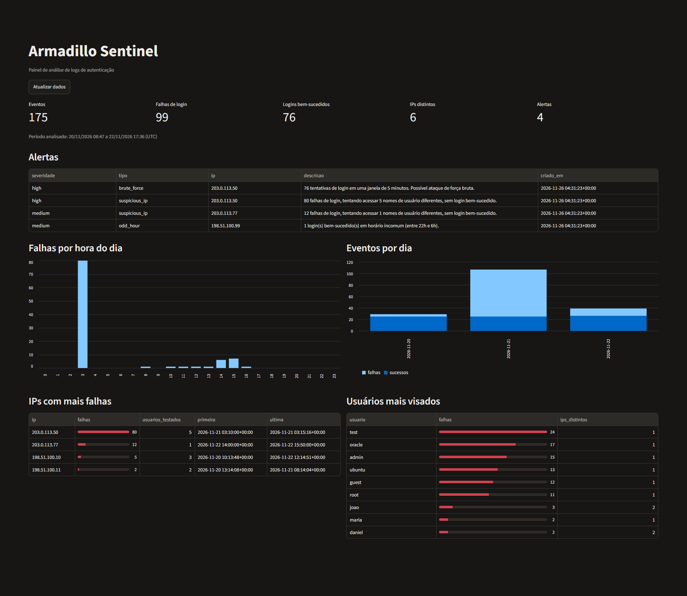

# Armadillo Sentinel


Analisador de logs de autenticação que identifica comportamentos suspeitos: tentativas excessivas de login (força bruta), IPs suspeitos e acessos em horários incomuns. Os eventos ficam em PostgreSQL e o resultado aparece em relatórios estatísticos e num dashboard.



> Os dados do print são fictícios: vêm de um log de exemplo gerado por script, com IPs das faixas reservadas para documentação.

## Funcionalidades

- Importação de logs `auth.log` (formato syslog do SSH), sem duplicar eventos ao reimportar
- Detecção de força bruta, IPs suspeitos e logins em horário incomum, com alertas gravados no banco
- Relatórios estatísticos com Pandas (top IPs, usuários mais visados, falhas por hora e por dia), exportáveis em CSV
- Dashboard web com Streamlit
- Execução padronizada com Docker Compose

## Como funciona

```text
auth.log
   |
   v
Parser
   |
   v
PostgreSQL (log_events)
   |
   v
Detectores de segurança
   |
   v
PostgreSQL (alerts)
   |
   +----> Relatórios estatísticos (Pandas)
   |
   +----> Dashboard (Streamlit)
```

## Detectores

| Alerta | Regra |
|---|---|
| `brute_force` | Muitas falhas de login do mesmo IP numa janela de 5 minutos |
| `suspicious_ip` | IP com muitas falhas, várias contas testadas e nenhum login bem-sucedido |
| `odd_hour` | Login bem-sucedido entre 22h e 6h |

Os limites ficam no topo de `src/armadillo_sentinel/detectors.py`. Os horários do log são tratados como UTC.

## Como rodar (Docker)

Pré-requisito: Docker com Compose (por exemplo, Docker Desktop).

```bash
git clone https://github.com/danielrlemes06-dotcom/armadillo-sentinel.git
cd armadillo-sentinel
cp .env.example .env
docker compose up -d --build
docker compose exec app sentinel import data/samples/auth.log
docker compose exec app sentinel detect
```

Abra http://localhost:8501 para ver o dashboard.

## Usando seus próprios logs

Coloque o arquivo em `data/raw/` (pasta ignorada pelo Git) e importe:

```bash
docker compose exec app sentinel import data/raw/meu_auth.log
docker compose exec app sentinel detect
```

## Comandos

| Comando | O que faz |
|---|---|
| `sentinel import <arquivo>` | Importa um log para o banco |
| `sentinel detect` | Roda os detectores e grava os alertas |
| `sentinel alerts` | Lista os alertas |
| `python -m armadillo_sentinel.reports [--csv]` | Relatórios estatísticos, com exportação opcional em CSV |

Para gerar outro log de exemplo:

```bash
python scripts/gen_sample_log.py
```

## Desenvolvimento local

```bash
docker compose up -d db
python -m venv .venv
.venv\Scripts\activate
pip install -e .
streamlit run src/armadillo_sentinel/dashboard.py
```

## Estrutura

```text
src/armadillo_sentinel/   parser, db, detectors, reports, dashboard, cli
sql/schema.sql            tabelas log_events e alerts
scripts/                  gerador de log de exemplo
data/samples/             log de exemplo (fictício)
docs/img/                 imagens do README
Dockerfile
docker-compose.yml
```

## Segurança

- O `.env` não é versionado; use o `.env.example` como modelo.
- Banco e dashboard escutam apenas em `127.0.0.1`.
- O container da aplicação roda com usuário sem privilégios.
- Os dados de exemplo são fictícios.

## Roadmap

- [x] Importação com deduplicação
- [x] Detectores e alertas
- [x] Relatórios e dashboard
- [x] Docker Compose
- [x] Testes automatizados (pytest)
- [ ] Adaptador para logs JSON do Cowrie (honeypot SSH)
- [ ] Demo pública com dados fictícios

## Licença

MIT
